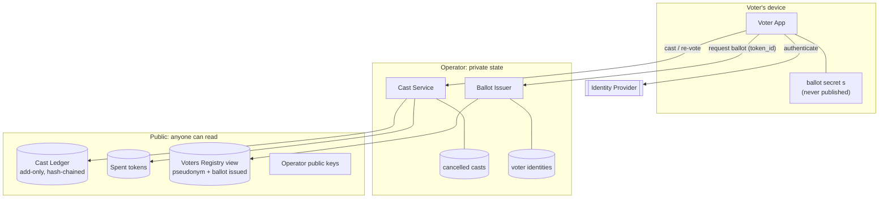

# 2. Actors and threat model

## Actors

| Actor | Role | Honest in v1? |
|-------|------|---------------|
| **Voter** | Gets a ballot, casts, may re-vote, checks their receipt | May try to cheat |
| **Voting Owner** | Creates the voting, defines the subjects, imports eligible voters, opens and closes the voting | May try to cheat, for example with malicious subject data |
| **Operator** | Runs the Ballot Issuer and the Cast Service, and holds the signing keys | **Trusted** for secrecy and for the legitimacy of cancellations. Everything else is checked |
| **Identity Provider (IdP)** | A plugin that confirms the voter is who they claim to be (mock email, eID, bank ID, …) | Trusted for identity only |
| **Auditor / Observer** | Anyone. Reads the public data and recomputes the tally and invariants | n/a |
| **Coercer / Vote buyer** | Wants proof of how a voter voted, or watches them vote | Adversary |

## Trust boundaries

## Threats

Status meanings:

- ✅ **mitigated** by the design and checkable
- 🟡 **trusted**: relies on an honest operator in v1, and the roadmap removes this
- 🔴 **open**: not addressed yet, see [open questions](07-open-questions.md)

| ID | Threat | Attacker | Mitigation | Status |
|----|--------|----------|-----------|--------|
| T1 | Ineligible person votes | Voter | Voters Registry plus IdP check before issuing a ballot | ✅ (only as good as the IdP) |
| T2 | Voter obtains two first ballots | Voter | The registry `ballot_issued` flag is set atomically with issuance, and the public count is checkable (I4) | ✅ |
| T3 | Same ballot token cast twice (replay) | Voter | Public spent-token set, checked before casting | ✅ |
| T4 | Forged ballot token | Voter, outsider | The Issuer's Ed25519 signature on `token_id` is checked when casting | ✅ |
| T5 | One ballot counted for both `yes` and `no` | Voter | A token yields exactly **one** cast, with exactly one option per subject. This replaces the old PoC's "issue both contracts" | ✅ |
| T6 | Cancelling a vote you never cast, or someone else's vote | Voter | A cancel needs the secret `s` of a spent token whose cast is not yet cancelled. Per-option totals can never go negative (I2) | ✅ |
| T7 | Cancelling the same cast twice | Voter | The operator keeps a private cancelled-casts set | 🟡 |
| T8 | Coercer demands the receipt | Coercer | A receipt proves the cast was *recorded*, not that it is *final*. Cancellations are not publicly linked. This holds only if the coercer cannot pick out the cancellation by timing or by a rare option (T17) | ✅ in principle, 🔴 until T17 is solved |
| T9 | Coercer watches the voter vote | Coercer | The voter re-votes later, in private | ✅ |
| T10 | Coercer stays with the voter until the voting closes ("last-minute coercion") | Coercer | Not addressed | 🔴 [Q4](07-open-questions.md) |
| T11 | Coercer takes the voter's ballot secret `s` | Coercer | Not addressed. Whoever holds `s` controls the re-votes | 🔴 [Q5](07-open-questions.md) |
| T12 | Operator links voters to their tokens (logs at issuance, timing) | Operator | v1: trusted not to misuse the voter-to-token link it holds (it keeps one for retries, see F2). Roadmap: blind signatures and an anonymous channel | 🟡 |
| T13 | Operator stuffs ballots for voters who never requested one | Operator | Public invariants I4 and I6 cap net votes at the number of ballots issued. Each voter can see their own `ballot_issued` flag | ✅ (detectable by the affected voter) |
| T14 | **Operator flips votes** by inventing a cancellation and casting a re-vote ballot it minted for itself | Operator | v1: **not detectable**, because every public invariant still holds. Roadmap: zero-knowledge cancellations | 🟡 **main residual risk** |
| T15 | Operator rewrites or forks the ledger history | Operator | Hash chain plus signed entries, and observers keep the latest head. Roadmap: anchor the head publicly, with clients checking every ledger they are served against the latest public anchor | ✅ against rewrites seen by observers, 🟡 against forks served to different people |
| T16 | Code injection through data (subject IDs etc.) | Voting Owner | Entries are validated data, not generated code (D2) | ✅ |
| T17 | Small anonymity set. Each `-1` entry shows its subject and option, so what matters is how many other cancellations share the **same subject and option** in the same publication window. A rare option, or a cancellation published right after the voter was seen re-voting, can be attributed | Coercer, operator | Not addressed. Batching per subject and option, delayed publication or dummy entries are possible | 🔴 [Q6](07-open-questions.md) |
| T18 | Denial of service | Outsider | Out of scope for the demo | n/a |

### The core trade-off, stated plainly

T8 and T14 are the same property seen from two sides. Because a cancellation is not publicly linked to
its cast, **a coercer cannot see that a vote was cancelled**, and **neither can the voter whose vote a
dishonest operator cancelled**. In v1 that gap is covered by trusting the operator. The roadmap closes
it by requiring a zero-knowledge proof that the canceller knows the cast's secret, without revealing
which cast it is ([5](05-trust-model-and-roadmap.md)).
