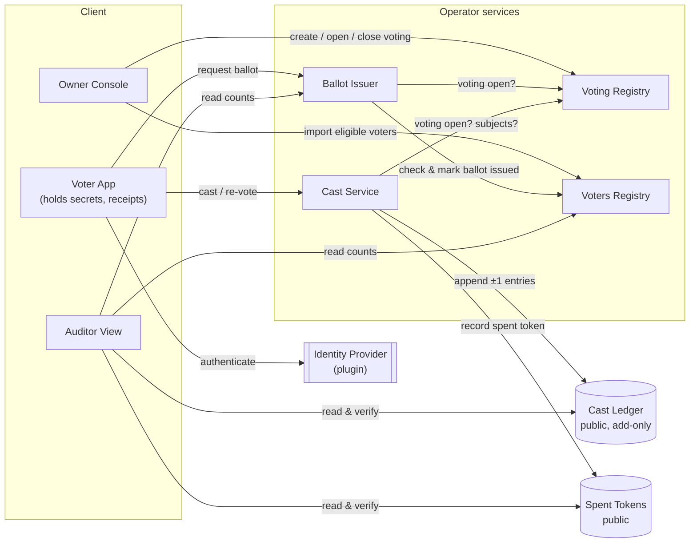
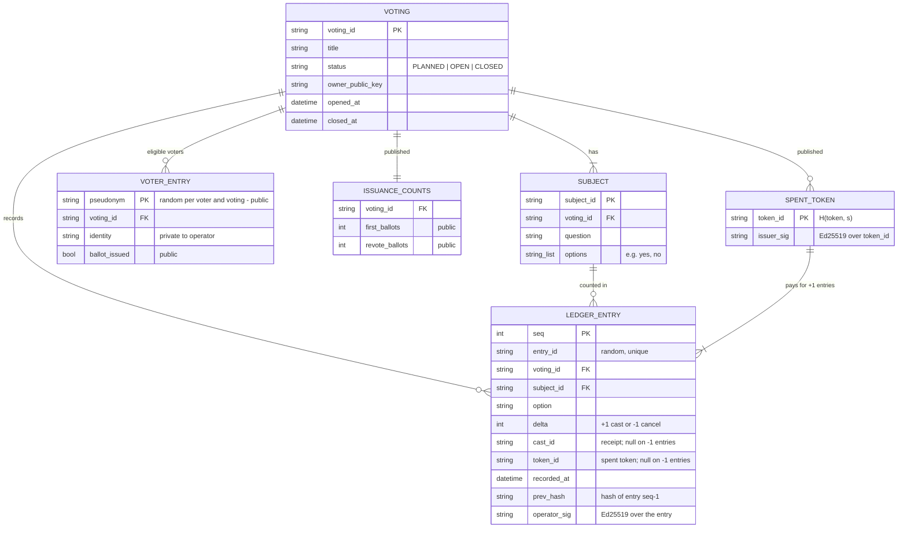
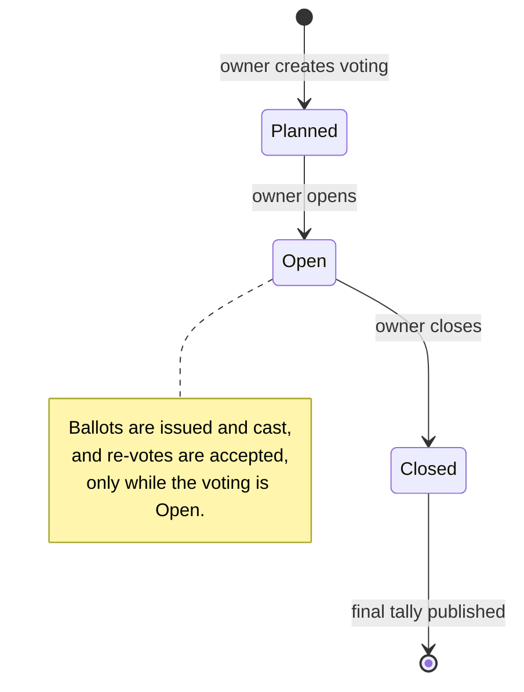
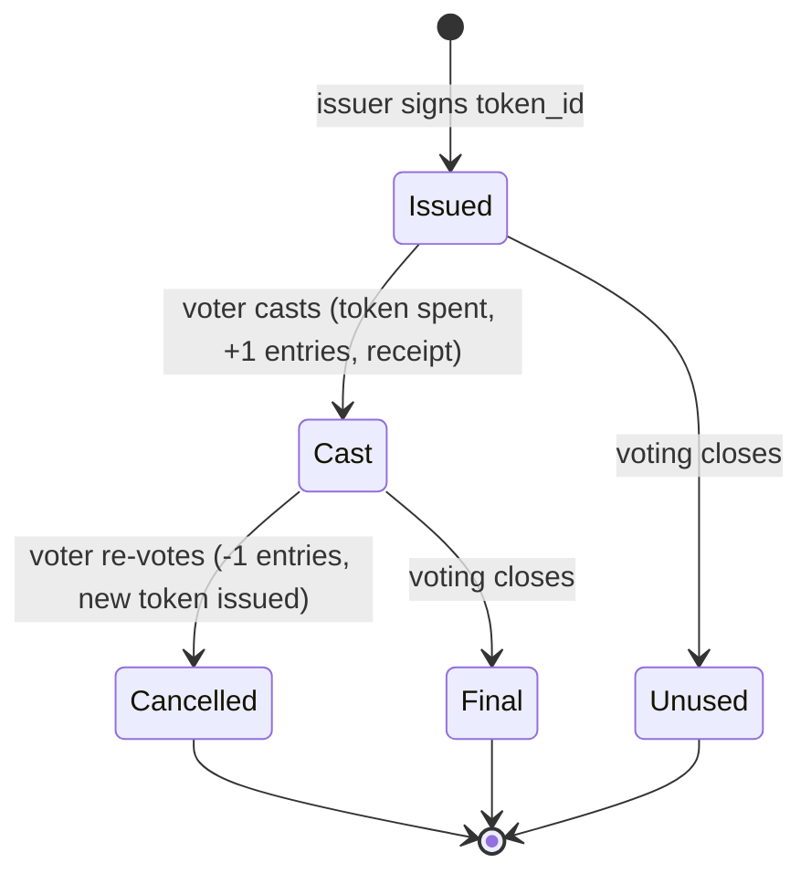

# 3. Concept and data model

## Building blocks

1. **Ballot token.** The voter's device generates a random secret `s` and asks the Ballot Issuer to sign
   `token_id = H("token" ‖ s)`. The signed token is an anonymous ballot covering every subject of the
   voting. A token can be cast exactly once.
2. **Cast.** The voter submits the token together with one option per subject. The Cast Service checks
   the token, marks it spent, and appends one `+1` ledger entry per subject. All of them carry
   `cast_id = H("cast" ‖ s)`, which is the voter's **receipt**, and the `token_id` that paid for the
   cast, so anyone can check that every cast is backed by its own valid ballot.
3. **Re-vote.** The voter reveals `s` of their current cast, privately to the Cast Service, together with
   a new `token_id'`. The service checks that the cast exists and has not been cancelled yet. It then
   appends one `-1` entry per subject for the old options and signs `token_id'` as a new ballot. The
   `-1` entries have **no `cast_id`** and use fresh random IDs, so nothing in public data says which
   cast they cancel.
4. **Add-only ledger.** Entries are never changed. The tally is the plain sum of deltas, so anyone can
   recompute it.
5. **The rule ("contract").** How an entry changes the tally is a small, published, deterministic
   function over **validated data**. No code is generated or executed from data (decision D2).

## Components



| Component | Responsibility | Public output |
|-----------|----------------|---------------|
| Voting Registry | Votings, subjects, options, lifecycle | Voting definition and status changes, signed by the owner |
| Voters Registry | Eligible voters per voting. Real identity stays private | Pseudonym plus `ballot_issued` flag for each eligible voter |
| Ballot Issuer | Signs `token_id`s for eligible voters (first ballot) and for re-votes | Number of tokens issued, split into first ballots and re-vote ballots |
| Cast Service | Accepts casts and re-votes. Prevents replay and double cancellation | Ledger entries and the spent-token set |
| Cast Ledger | Add-only, hash-chained log of signed `±1` entries | Everything |
| Voter App | Generates and keeps `s`, shows receipts, finds them in the ledger | n/a |
| Auditor | Pure functions: verify signatures and chain, recompute tally, check invariants | Anyone can run it |

## Data model



Private operator state, never published:

| Store | Content | Why it is private |
|-------|---------|-------------------|
| Voter identities | `pseudonym → identity` | Ballot secrecy (R4). The pseudonym is random, so nobody can recompute it from a guessed identity (for example an email address) |
| Cancelled casts | Set of `cast_id`s that have been cancelled | Publishing it would show the coercer that the receipt was cancelled (T8) |

Publishing `token_id` with each cast reveals nothing new to the public. Only the issuer could link a
`token_id` to a voter, it is already trusted for that in v1 (T12), and blind signatures remove even that
link ([RM1](05-trust-model-and-roadmap.md#rm1-blind-signature-issuance-removes-t12)).

### Example entries

A cast on a voting with two subjects produces two entries that share a receipt:

```json
{ "seq": 41, "entry_id": "e-8f2c", "subject_id": "budget", "option": "yes", "delta": 1, "cast_id": "c-71ab…", "token_id": "t-3e9f…", "prev_hash": "…", "operator_sig": "…" }
{ "seq": 42, "entry_id": "e-1d90", "subject_id": "board",  "option": "no",  "delta": 1, "cast_id": "c-71ab…", "token_id": "t-3e9f…", "prev_hash": "…", "operator_sig": "…" }
```

A later re-vote of that cast produces `-1` entries with no receipt, published one subject at a time:

```json
{ "seq": 97,  "entry_id": "e-55aa", "subject_id": "budget", "option": "yes", "delta": -1, "cast_id": null, "token_id": null, "prev_hash": "…", "operator_sig": "…" }
{ "seq": 103, "entry_id": "e-0c3e", "subject_id": "board",  "option": "no",  "delta": -1, "cast_id": null, "token_id": null, "prev_hash": "…", "operator_sig": "…" }
```

Cancellations are split per subject and carry no shared ID. A whole-ballot cancel entry would carry the
full option pattern, which can identify the original cast when there are many subjects. See
[Q3](07-open-questions.md) and [Q6](07-open-questions.md).

In v1, `-1` entries carry no reference at all, and their legitimacy is trusted to the operator (T14).
In v2 each `-1` entry will instead reference a public cancellation record holding a nullifier and a
zero-knowledge proof ([RM2](05-trust-model-and-roadmap.md#rm2-zero-knowledge-cancellations-removes-t7-and-t14)).

## Lifecycles

### Voting



### Ballot token



## Public invariants

Anyone can check all of these from public data alone. `N` is the number of subjects.

| ID | Invariant | Detects |
|----|-----------|---------|
| I1 | Every entry's `prev_hash` matches the previous entry, and every `operator_sig`, owner signature and issuer signature verifies | Tampering, forged entries |
| I2 | For every `(subject, option)`, the running sum of deltas is never negative | Cancelling more than was cast |
| I3 | Each `cast_id` has exactly one `+1` entry per subject, all with the same `token_id`. That `token_id` is in the spent-token set with a valid issuer signature, and no `token_id` backs more than one `cast_id` | Casts without a ballot, partial ballots |
| I4 | `first_ballots` = number of registry entries with `ballot_issued`, and that is ≤ the registry size | Ballots for non-voters, stuffing |
| I5 | `revote_ballots` = number of cancellations = the count of `-1` entries for any one subject, and that count is the same for every subject | Re-vote ballots without a cancellation |
| I6 | Net casts (casts − cancellations) ≤ `first_ballots` | Stuffing, which follows from I3–I5 |
| I7 | Every entry falls between the owner-signed open and close events | Votes outside the voting window |

What these invariants **cannot** show: whether each cancellation cancels a cast whose secret the
canceller actually knows. That is threat T14, covered in [5](05-trust-model-and-roadmap.md).
