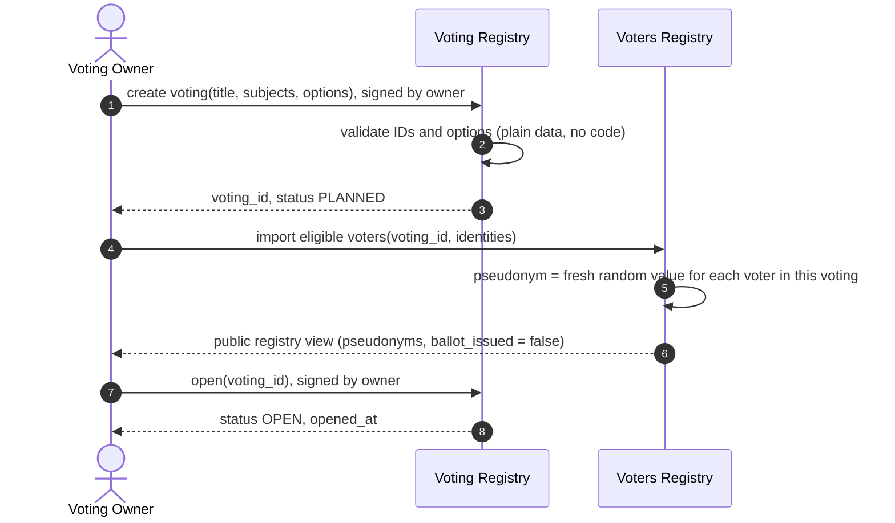
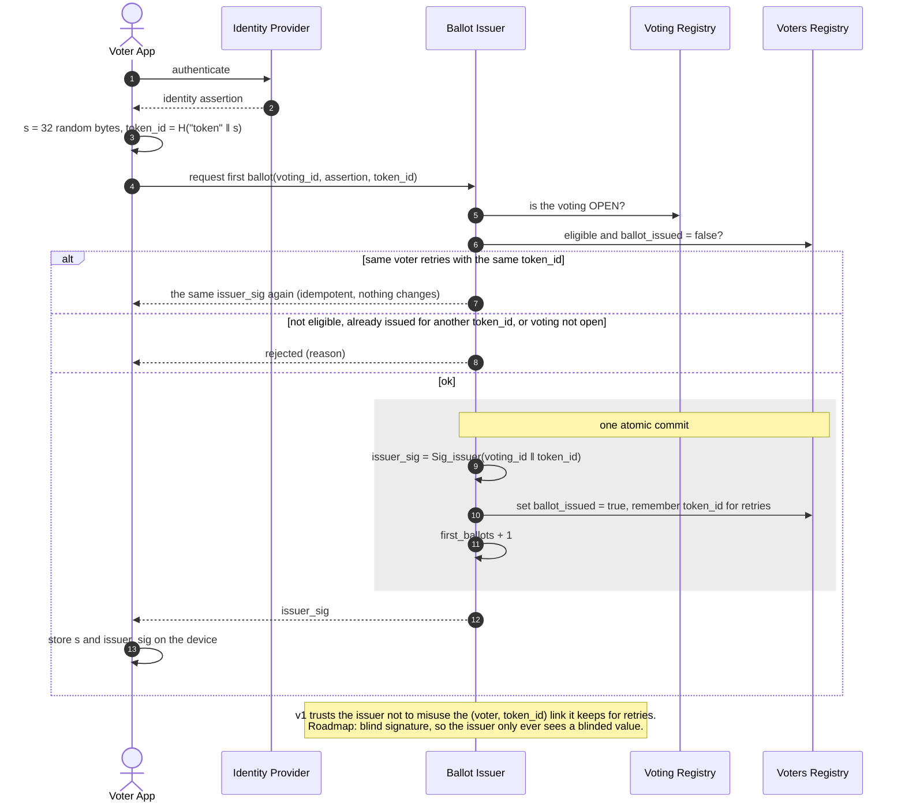
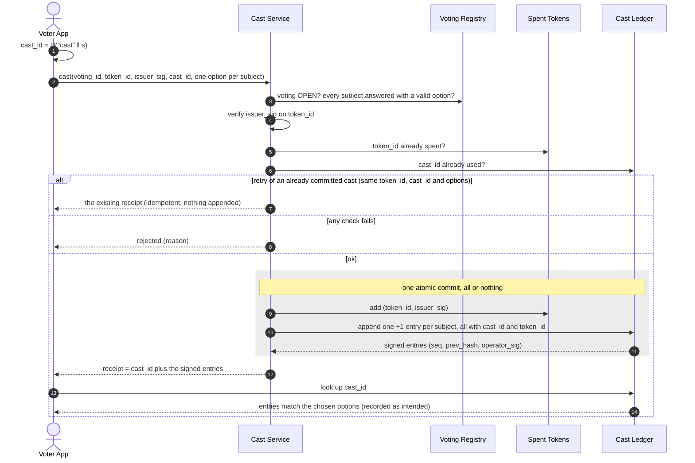
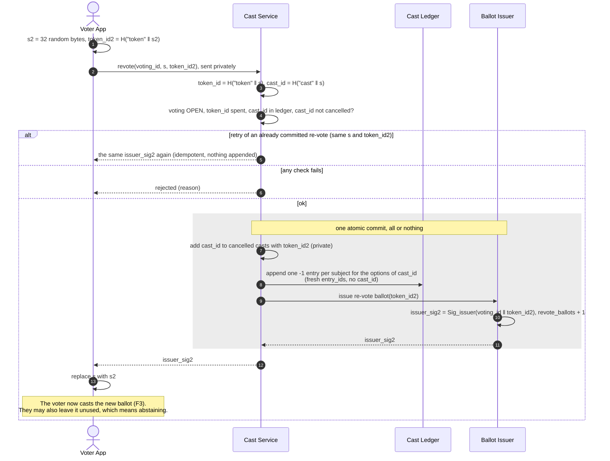
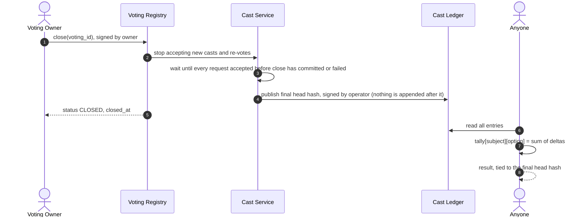
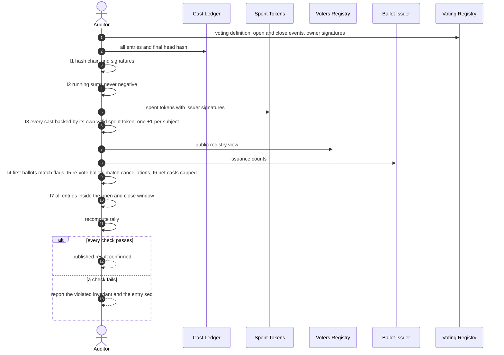
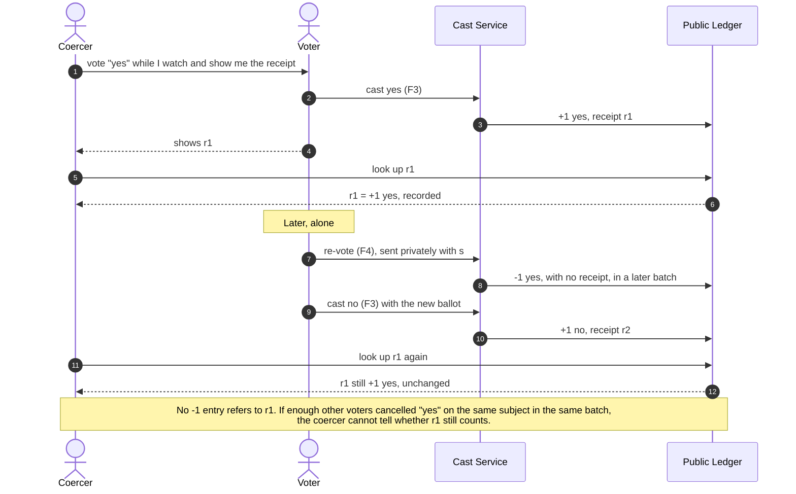
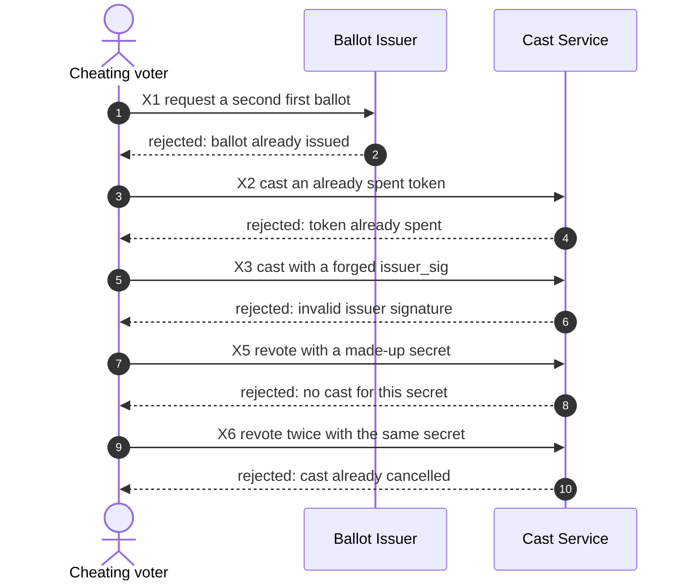

# 4. Flows

Each flow has a sequence diagram. Every rejection drawn here is one the demo must actually show.
Flows F1–F7 are the normal use cases. F8 lists the cheating attempts for the demo's "try to cheat" panel.

- [F1. Set up a voting](#f1-set-up-a-voting)
- [F2. Get a ballot](#f2-get-a-ballot)
- [F3. Cast](#f3-cast)
- [F4. Re-vote](#f4-re-vote)
- [F5. Close and tally](#f5-close-and-tally)
- [F6. Audit](#f6-audit)
- [F7. Coercion scenario](#f7-coercion-scenario)
- [F8. Cheating attempts](#f8-cheating-attempts)

---

## F1. Set up a voting

## F2. Get a ballot

## F3. Cast

`cast_id` is computed by the voter. If a voter sends something that is not `H("cast" ‖ s)`, the only
effect is that they cannot re-vote later. A duplicate `cast_id` is rejected.

## F4. Re-vote

The voter's old receipt stays in the ledger unchanged. Whether `-1` entries are published right away or
in shuffled batches is [Q6](07-open-questions.md).

### Consistency and retries (F2–F4)

- **Every state change is one atomic commit.** Nothing is partly applied: a ballot is not marked issued
  without its signature and count, a token is not marked spent without all of its `+1` entries, and a
  cast is not cancelled without its `-1` entries and its new ballot. The demo runs all services in one
  process, so each commit is a single in-memory transaction. A real backend needs one database
  transaction, or a write-ahead log across the services.
- **A failure before the commit changes nothing**, so the voter can simply try again.
- **Retries are idempotent**, keyed by values the voter already holds: `token_id` in F2,
  `token_id` + `cast_id` in F3, and `s` + `token_id2` in F4. If a response is lost after the commit,
  repeating the request returns the same result instead of an error, so no ballot is ever stranded.
- **The cost of F2 retries:** to recognise a retry, the issuer keeps `token_id` next to the voter's
  pseudonym. That is exactly the link T12 trusts the issuer not to misuse. With blind signatures (RM1)
  it keeps only the blinded value, which reveals nothing.

## F5. Close and tally

## F6. Audit

## F7. Coercion scenario

This assumes the coercer does not stay with the voter until the voting closes (T10) and does not take
`s` (T11), and that enough other cancellations of the **same subject and option** are published in the
same window, so neither timing nor a rare option singles out this one (T17). See
[2](02-actors-and-threat-model.md).

## F8. Cheating attempts

Each of these is a button in the demo's "try to cheat" panel. Each must be rejected or detected
visibly, with a reason that refers to the design.

| # | Attempt | Where it is stopped | Reason shown |
|---|---------|---------------------|--------------|
| X1 | Request a second first ballot | Ballot Issuer (F2) | "Ballot already issued to this voter" (T2) |
| X2 | Cast the same token twice | Cast Service (F3) | "Token already spent" (T3) |
| X3 | Cast with a forged or altered issuer signature | Cast Service (F3) | "Invalid issuer signature" (T4) |
| X4 | Cast with two options for one subject, or skip a subject | Cast Service (F3) | "Invalid ballot" (T5) |
| X5 | Re-vote with a made-up secret | Cast Service (F4) | "No cast for this secret" (T6) |
| X6 | Re-vote twice with the same secret | Cast Service (F4) | "Cast already cancelled" (T7) |
| X7 | Cast or re-vote after the voting closes | Cast Service (F3/F4) | "Voting is not open" (I7) |
| X8 | Create a subject whose ID contains code or quotes | Voting Registry (F1) | "Invalid identifier" (T16) |
| X9 | Edit an entry in a copy of the ledger | Auditor (F6) | "I1 failed at entry seq N" (T15) |
| X10 | Add a `-1` entry without a cancellation | Auditor (F6) | "I5 failed: re-vote ballots ≠ cancellations" |

