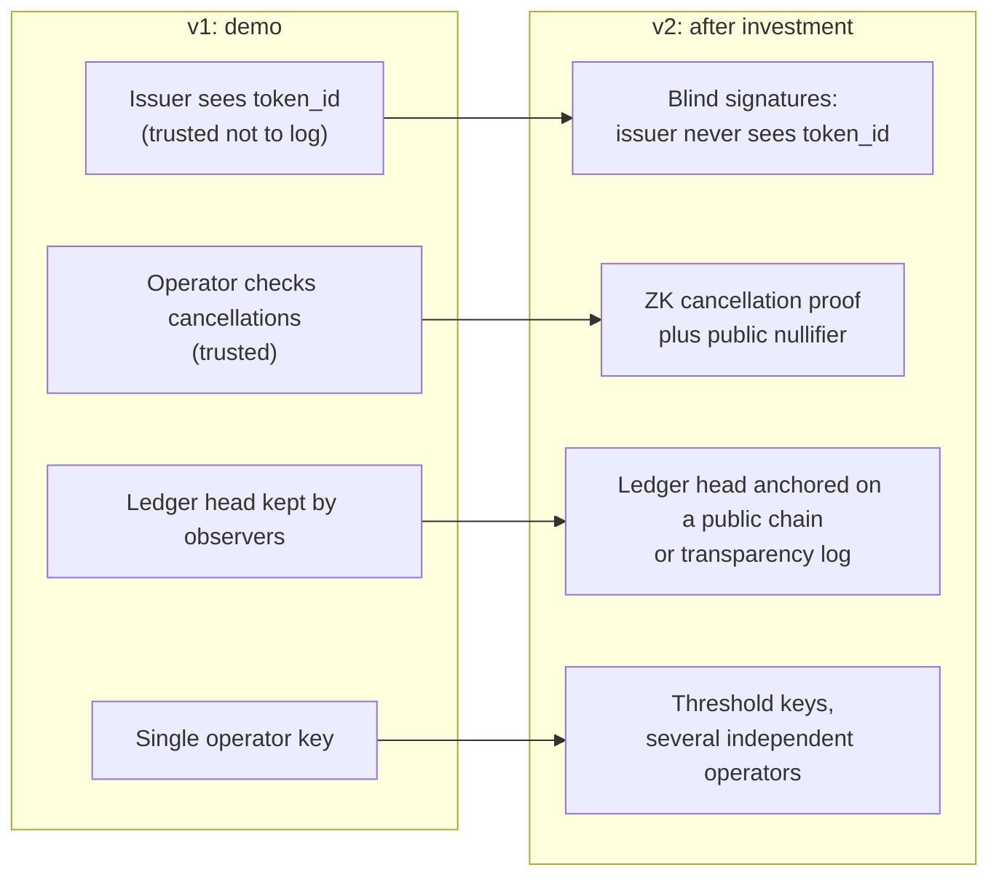

# 5. Trust model and roadmap

## Who can check what (v1)

| Property | Voter | Anyone | Trusted to the operator in v1 |
|----------|:-----:|:------:|:-----------------------------:|
| My cast was recorded as I chose (R5) | ✅ receipt lookup | | |
| The tally equals the sum of the ledger (R6) | ✅ | ✅ | |
| The ledger was not rewritten after I saw it (I1) | ✅ | ✅ | |
| No more net votes than ballots issued (R3, I3–I6) | ✅ | ✅ | |
| Nobody took a ballot in my name | ✅ own `ballot_issued` flag | | |
| Every cancellation was made by the holder of that cast's secret (T14) | | | 🟡 |
| No cast was cancelled twice (T7) | | | 🟡 |
| The issuer does not link my identity to my token (R4, T12) | | | 🟡 |
| Operator signing keys are not misused | | | 🟡 |

The 🟡 rows are the honest limits of v1. They match the position of MACI's coordinator, which can see
votes and must be trusted for privacy ([6](06-prior-art.md)).

## How the roadmap removes each trust assumption

### RM1. Blind-signature issuance (removes T12)

The voter blinds `token_id` before sending it. The issuer signs it without seeing it, and the voter
unblinds the signature. The issuer then cannot connect the identity it checked to any token that is
later spent. Blind RSA signatures (RFC 9474) are standard and can be built in a browser.

### RM2. Zero-knowledge cancellations (removes T7 and T14)

Every cast commits to its secret. To cancel, the voter publishes:

- a **nullifier** `N = H("cancel" ‖ s)`. It is unique per cast and cannot be linked to the cast without `s`.
- a **zero-knowledge proof** that "`N` comes from the secret of *some* cast in the ledger with options
  `X`, and I know that secret". The proof does not reveal which cast.

Anyone can verify the proof and check that `N` has not appeared before. After this, the operator can no
longer invent cancellations, and nobody can cancel the same cast twice. The coercer still cannot link
the cancellation to the receipt. This is the same mechanism MACI and Semaphore use.

### RM3. Public anchoring (removes T15 forks)

The operator regularly publishes the ledger head hash to a public blockchain or a transparency log.
After that it cannot show different histories to different observers.

### RM4. Threshold operators

Signing and issuing keys are split across independent parties, so no single operator can act alone.

## Why this order

RM2 removes the single biggest residual risk (T14, vote flipping by the operator) and is the strongest
technical claim for investors. RM1 is cheap and well understood. RM3 and RM4 matter for public or
high-stakes votings, and less for the first customers.
