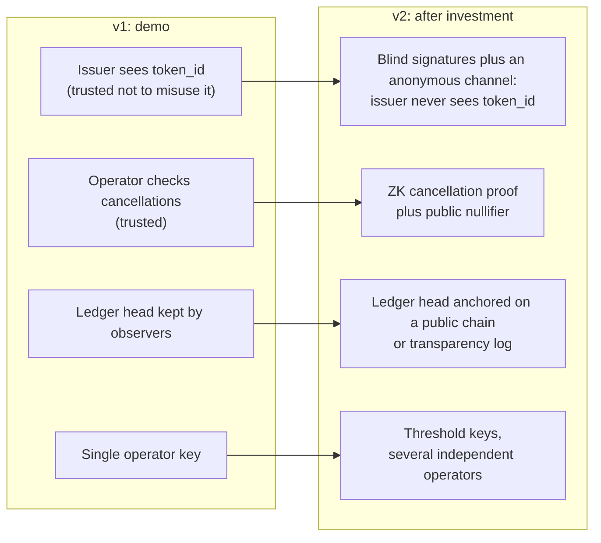

# 5. Trust model and roadmap

## Who can check what (v1)

| Property | Voter | Anyone | Trusted to the operator in v1 |
|----------|:-----:|:------:|:-----------------------------:|
| My cast was recorded as I chose (R5) | ✅ receipt lookup | | |
| The tally equals the sum of the ledger (R6) | ✅ | ✅ | |
| The ledger was not rewritten after I saw it (I1) | ✅ | ✅ | |
| No more net votes than ballots issued (R3, I3–I6) | ✅ | ✅ | |
| Nobody took a ballot in my name | ✅ own `ballot_issued` flag | | |
| Every cancellation was made by the holder of that cast's secret (T14) | | | 🟡 |
| No cast was cancelled twice (T7) | | | 🟡 |
| The issuer does not link my identity to my token (R4, T12) | | | 🟡 |
| Operator signing keys are not misused | | | 🟡 |

The 🟡 rows are the honest limits of v1. Only one of them matches MACI: like MACI's coordinator, the v1
operator can see how people voted and is trusted to keep that private. The others go further than MACI.
MACI's proofs stop even its coordinator from producing a false tally, while the v1 operator could flip
votes without being detected (T14). See [6](06-prior-art.md).

## How the roadmap removes each trust assumption

### RM1. Blind-signature issuance (removes T12)

The voter blinds `token_id` before sending it. The issuer signs it without seeing it, and the voter
unblinds the signature. Blind RSA signatures (RFC 9474) are standard and can be built in a browser.

Blinding hides only the *message*, so the issuer can no longer link the identity it checked to a spent
token **cryptographically**. It can still link them through network metadata: the IP address, the
device, or a cast arriving seconds after issuance. RM1 therefore also needs casts and re-votes to travel
over an **anonymous channel** (for example Tor or an oblivious HTTP relay) and to be decoupled in time
from issuance. Without that, RM1 removes the cryptographic link but not the metadata link.

### RM2. Zero-knowledge cancellations (removes T7 and T14)

This is a **proposed design**, not an existing scheme. T14 counts as removed only once it is specified
in full and implemented.

Every `+1` entry is a leaf `(cast_id, subject_id, option)` in a Merkle tree whose root `R` is published
with the ledger head. To cancel one subject of a cast, the voter publishes a **cancellation record**:

| Field | Meaning |
|-------|---------|
| `cancel_id` | Random ID of this record |
| `voting_id`, `subject_id`, `option` | The exact `-1` that will be applied |
| `N` | Nullifier `H("cancel" ‖ voting_id ‖ subject_id ‖ s)`. Unique per cast and subject, and cannot be linked to the cast without `s` |
| `R` | The Merkle root the proof refers to. It must be a root the ledger has published |
| `π` | Zero-knowledge proof |

`π` proves: *"I know an `s` such that `(H("cast" ‖ s), subject_id, option)` is a leaf under `R`, and
`N = H("cancel" ‖ voting_id ‖ subject_id ‖ s)."* Its public inputs are `voting_id`, `subject_id`,
`option`, `N`, `R` and `cancel_id`, so a proof cannot be replayed for a different entry. The proof does
not reveal which leaf.

The matching ledger entry is exactly `{voting_id, subject_id, option, delta: -1, cancel_ref: cancel_id}`.
It replaces the v1 entry that has no reference at all. An auditor accepts a `-1` entry only if its
record's proof verifies with exactly these public inputs, `R` is a published root, and `N` has not
appeared before.

The result: the operator can no longer invent cancellations, nobody can cancel the same cast and subject
twice, and the coercer still cannot link the cancellation to the receipt. Nullifiers are per subject, so
the records of one re-vote are not linked to each other (see the option-pattern note in
[3](03-concept-and-data-model.md)).

Still open: how to require that a voter cancels **every** subject before receiving a re-vote ballot
(D5) without linking the per-subject records ([Q3](07-open-questions.md)).

The membership-proof-plus-nullifier pattern is the one Semaphore provides. MACI uses zero-knowledge
proofs for something else: proving that its coordinator processed the messages and tallied correctly.

### RM3. Public anchoring (removes T15 forks)

The operator regularly publishes the ledger head hash to a public blockchain or a transparency log.

Publishing an anchor alone does not stop the operator from serving a stale or different history to
someone. The protection comes from the **clients**: the Voter App and the Auditor fetch the latest
finalised anchor themselves, from the chain or log rather than from the operator, and reject any ledger
that does not match it. With that check in place, a fork is detected by anyone who looks.

### RM4. Threshold operators

Signing and issuing keys are split across independent parties, so no single operator can act alone.

## Why this order

RM2 removes the single biggest residual risk (T14, vote flipping by the operator) and is the strongest
technical claim for investors. RM1 is cheap and well understood. RM3 and RM4 matter for public or
high-stakes votings, and less for the first customers.
