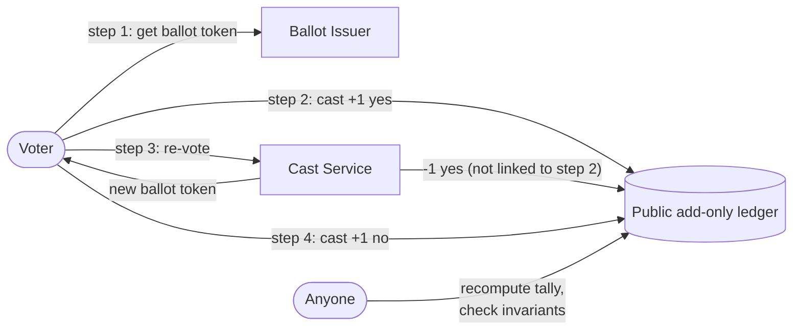

# E-Voting Machine: Design

> **Status:** draft for discussion. Nothing here is frozen until step 2 of [`PLAN.md`](../PLAN.md)
> is checked off.

The diagrams are written in [Mermaid](https://mermaid.js.org/), which GitHub renders directly.
The draft is based on the earlier write-up in `dsame/e-voting` and on the pitch decks in `doc/`.

## Contents

| # | Document | What it answers |
|---|----------|-----------------|
| 1 | [Problem and requirements](01-problem-and-requirements.md) | What a voting system must guarantee and what this project adds |
| 2 | [Actors and threat model](02-actors-and-threat-model.md) | Who takes part, who attacks, and what each attacker can do |
| 3 | [Concept and data model](03-concept-and-data-model.md) | Ballot tokens, the add-only ledger, re-voting by cancellation |
| 4 | [Flows](04-flows.md) | Step-by-step sequence diagrams for every use case |
| 5 | [Trust model and roadmap](05-trust-model-and-roadmap.md) | What anyone can verify, what is trusted in v1, how later versions remove that trust |
| 6 | [Prior art](06-prior-art.md) | Estonia, Helios, JCJ/Civitas, MACI, and how this design differs |
| 7 | [Open questions](07-open-questions.md) | Decisions still to make |

## The idea in one paragraph

A voter receives an anonymous **ballot token** and casts it into a public, **add-only ledger**.
Each cast adds `+1` to the chosen options and gives the voter a **receipt** they can find in the ledger.
A voter may **re-vote** at any time while the voting is open. The service then adds a `-1`
**cancellation** for the earlier choice and hands out a new ballot token. Nothing is ever deleted or
edited. Cancellations are deliberately **not publicly linked** to the cast they cancel, so a coercer
shown a receipt cannot tell whether that vote still counts. That is what makes buying or forcing a
vote pointless.

## Notation

| Symbol | Meaning |
|--------|---------|
| `H(x)` | SHA-256 |
| `Sig_K(x)` | Ed25519 signature with key `K` |
| `s` | A ballot secret, generated on the voter's device and never published |
| `token_id = H("token" ‖ s)` | Public identifier of a ballot token |
| `cast_id = H("cast" ‖ s)` | Public identifier of a cast, which is the voter's receipt |

## Decision log

Proposed decisions. Each one becomes **Accepted** or is replaced during step 2 of the plan.

| ID | Decision | Status | Why |
|----|----------|--------|-----|
| D1 | The demo is a single TypeScript app that runs entirely in the browser | Proposed | One language, nothing to deploy, no infrastructure that can fail during a pitch |
| D2 | Ledger entries are **validated data** processed by a published, deterministic rule, not generated code ("smart contracts" as pure functions) | Proposed | Removes the code-injection class of bugs and is easier to audit |
| D3 | Signatures are Ed25519 public-key signatures, and hashing is SHA-256 | Proposed | Anyone can verify an entry without holding a secret, unlike the current MD5 shared-secret scheme |
| D4 | v1 uses a **trusted operator** for issuer unlinkability and cancellation legitimacy, and says so openly | Proposed | Same position as MACI's coordinator. Removing the trust is on the roadmap ([5](05-trust-model-and-roadmap.md)) |
| D5 | Re-vote cancels the **whole ballot** (all subjects at once) and issues a whole new ballot | Proposed | Fewer linkable events. See [Q3](07-open-questions.md) |
| D6 | The ledger is hash-chained, and the operator signs every entry | Proposed | Makes rewriting history detectable. Anchoring the chain head publicly is on the roadmap |
